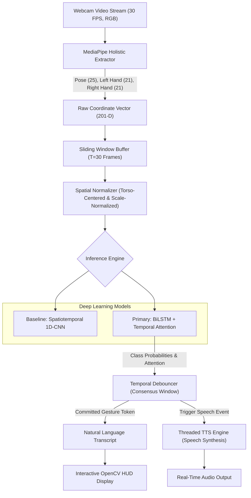

# System Architecture & Technical Specifications
## Sign Language Recognition and Translation Assistant

---

## 1. System Topology & End-to-End Pipeline

---

## 2. Layer-by-Layer Architecture Comparison

### 2.1 Baseline Architecture: Spatiotemporal 1D-CNN
The baseline model treats the temporal sequence of landmark coordinates as a 1D multi-channel signal $(\text{Channels}=201, \text{Length}=30)$.

| Layer Name | Type | Input Shape | Output Shape | Parameters | Activation / Details |
| :--- | :--- | :--- | :--- | :--- | :--- |
| **Input Permute** | Transpose | $(B, 30, 201)$ | $(B, 201, 30)$ | $0$ | Channel-first layout |
| **Conv1D_1** | Conv1d + BN | $(B, 201, 30)$ | $(B, 64, 30)$ | $64,384$ | Kernel=5, Pad=2, ReLU |
| **Conv1D_2** | Conv1d + BN | $(B, 64, 30)$ | $(B, 128, 30)$ | $41,216$ | Kernel=5, Pad=2, ReLU |
| **Pool_1** | MaxPool1d | $(B, 128, 30)$ | $(B, 128, 15)$ | $0$ | Kernel=2, Stride=2 |
| **Dropout_1** | Dropout | $(B, 128, 15)$ | $(B, 128, 15)$ | $0$ | $p = 0.3$ |
| **Conv1D_3** | Conv1d + BN | $(B, 128, 15)$ | $(B, 256, 15)$ | $98,816$ | Kernel=3, Pad=1, ReLU |
| **Dropout_2** | Dropout | $(B, 256, 15)$ | $(B, 256, 15)$ | $0$ | $p = 0.3$ |
| **GlobalAvgPool** | AdaptiveAvgPool1d | $(B, 256, 15)$ | $(B, 256, 1)$ | $0$ | Temporal collapse |
| **Flatten** | Squeeze | $(B, 256, 1)$ | $(B, 256)$ | $0$ | Vector representation |
| **FC_1** | Linear + BN | $(B, 256)$ | $(B, 128)$ | $33,024$ | Dense projection, ReLU |
| **Dropout_3** | Dropout | $(B, 128)$ | $(B, 128)$ | $0$ | $p = 0.3$ |
| **Classifier** | Linear | $(B, 128)$ | $(B, 10)$ | $1,290$ | Softmax output |
| **Total Params** | — | — | — | **~238,730** | Trainable parameters |

---

### 2.2 Proposed Primary Architecture: BiLSTM with Temporal Attention
The primary model explicitly captures sequential joint dynamics and dynamically weights critical gesture frames.

| Layer Name | Type | Input Shape | Output Shape | Parameters | Activation / Details |
| :--- | :--- | :--- | :--- | :--- | :--- |
| **Spatial Projection** | Linear + LayerNorm | $(B, 30, 201)$ | $(B, 30, 128)$ | $26,112$ | Projects coordinates to latent space |
| **BiLSTM Layer 1** | Bidirectional LSTM | $(B, 30, 128)$ | $(B, 30, 256)$ | $264,192$ | $H=128$, Forward + Backward |
| **Recurrent Dropout** | Variational Dropout | $(B, 30, 256)$ | $(B, 30, 256)$ | $0$ | $p = 0.25$ between layers |
| **BiLSTM Layer 2** | Bidirectional LSTM | $(B, 30, 256)$ | $(B, 30, 256)$ | $395,264$ | Hierarchical spatiotemporal features |
| **Attention Projection**| Linear | $(B, 30, 256)$ | $(B, 30, 128)$ | $32,896$ | Projects hidden states |
| **Attention Context** | Linear (no bias) | $(B, 30, 128)$ | $(B, 30, 1)$ | $128$ | Learnable vector $v_a$ |
| **Softmax** | Softmax (time-axis) | $(B, 30, 1)$ | $(B, 30)$ | $0$ | Normalized weights $\alpha_t$ |
| **Context Pooling** | Batch Matrix Mult | $(B, 1, 30) \times (B, 30, 256)$ | $(B, 256)$ | $0$ | Context vector $c = \sum \alpha_t h_t$ |
| **Dense Projection** | Linear + BatchNorm | $(B, 256)$ | $(B, 128)$ | $33,152$ | ReLU |
| **Dropout** | Dropout | $(B, 128)$ | $(B, 128)$ | $0$ | $p = 0.4$ |
| **Classifier** | Linear | $(B, 128)$ | $(B, 10)$ | $1,290$ | Output logits |
| **Total Params** | — | — | — | **~753,034** | Trainable parameters |

---

## 3. Justification of Key Architectural Decisions

1. **Why MediaPipe Landmarks instead of End-to-End 3D-CNN (e.g. I3D / SlowFast)?**
   - End-to-end video models require tens of gigabytes of GPU VRAM, tens of millions of parameters, and exhibit extreme sensitivity to background clutter, lighting variations, skin tone bias, and clothing differences.
   - Coordinate extraction decouples geometry from appearance: the model receives pure 3D kinematic trajectories, reducing input dimension from $30 \times 224 \times 224 \times 3 = 4,515,840$ bytes to $30 \times 201 \times 4 = 24,120$ bytes (a **187x data compression ratio**) with zero background noise.
2. **Why Bidirectional LSTM?**
   - In sign language recognition on sliding windows, a gesture's meaning often depends on its endpoint (e.g., whether the hand returns to rest, taps the chin, or moves outward). Bidirectional processing allows past frames to access future structural context.
3. **Why Additive Temporal Attention?**
   - Standard LSTMs suffer from recency decay when forced to compress an entire sequence into a single terminal hidden state $\mathbf{h}_T$. Attention allows the model to selectively query inflection frames (e.g., peak finger spread or contact) regardless of their temporal position.
4. **Why Label Smoothing ($\epsilon = 0.1$)?**
   - Many sign language signs share identical base handshapes (e.g., "Hello" vs "Goodbye" or "Water" vs "Number 3") differing only by subtle velocity. Hard targets ($1.0$ vs $0.0$) lead to overconfident saturated logits. Label smoothing penalizes extreme output distributions, improving out-of-distribution calibration.
